# ros2-aruco-world

[](https://github.com/KevDP/ros2-aruco-world/actions/workflows/ci.yml)

A mobile robot in a simulated room full of ArUco markers, built layer by layer in ROS 2. It reads
the markers, stops before it runs into anything, works out where it is and keeps track of it
between one marker and the next.

<p align="center">
  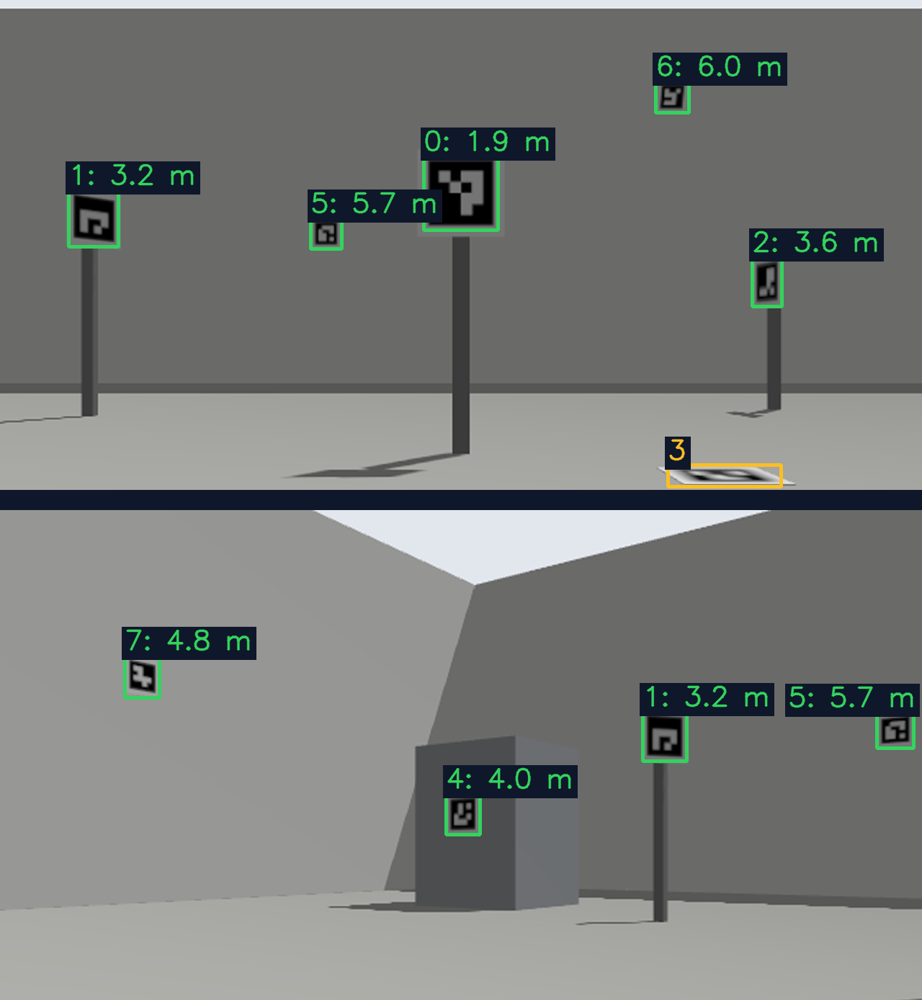
  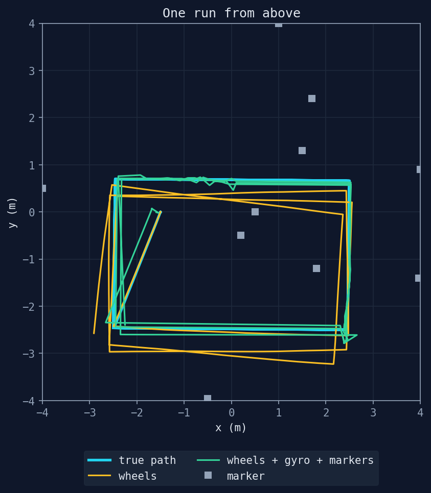
</p>

I studied Robotics, and my last robotics project was in ROS 1: a robot that drove to a goal while
avoiding obstacles with a lidar, reading ArUco markers along the way. Since then my work has moved
toward ML. This repository brings the two together, and it is the code behind my blog series
[Mobile robotics in simulation with ROS 2](https://kevdelgado.com/blog/robotica-movil-ros2-parte-1).

Each part of the series asks one question about the robot and answers it with an experiment that
compares what the robot believes with where it really is.

| Part | Topic | The question |
|---|---|---|
| [1](https://kevdelgado.com/blog/robotica-movil-ros2-parte-1) | The lab | How do I know that what the robot believes is true? |
| [2](https://kevdelgado.com/blog/robotica-movil-ros2-parte-2) | Perception | How far away can the robot read a marker, and how well does it know where that marker is? |
| [3](https://kevdelgado.com/blog/robotica-movil-ros2-parte-3) | Safety | How far ahead does the robot need to see something to stop before touching it, whatever its speed? |
| [4](https://kevdelgado.com/blog/robotica-movil-ros2-parte-4) | Spatial awareness | How well does the robot know where it is with a single marker in view? |
| [5](https://kevdelgado.com/blog/robotica-movil-ros2-parte-5) | Fusion | How well does the robot know where it is along a route, whether it sees markers or not? |
| 6 | Learning | Coming soon. |

ROS 2 Jazzy, Gazebo Harmonic and Ubuntu 24.04, tested under WSL2 on Windows 11.

## The problem

A fiducial marker is easy to read close up and straight on, and a robot rarely gets that view. The
marker is far away, turned, on the floor or above the camera, and between one marker and the next
the robot has nothing to look at. Testing those cases on real hardware is slow. A simulated camera
shows the same effects in seconds, every case can be repeated, and Gazebo computes the robot's true
pose at every instant, which is what every estimate here is checked against.

## Results

Each experiment runs a fixed scenario on a fresh simulation and compares the result with the true
pose. The full tables are in each experiment's `summary.md`, under `experiments/results/`.

| Layer | Result | Experiment |
|---|---|---|
| The lab | Turning in place, the robot reads at least one marker from 97% of the free floor. With sphere-shaped wheel collisions, its odometry turns as much as the robot does. | `visibility`, `turning` |
| Perception | Within 4 m and 45° of head-on, the detector reads 99% of the markers in view, none with a wrong id. Distances come out 1.8% to 3.4% long between 1 and 4 m. | `perception` |
| Safety | In 144 approaches at 0.15 to 0.6 m/s, the robot never touched the obstacle, and at every speed it came to rest a median of about 27 cm from it. | `stopping` |
| Localization | With a marker within 4 m, half the fixes land within about 8 cm of the robot and 9 in 10 within 17 cm, and 97.6% fall inside their own 95% ellipse. | `localization` |
| Fusion | Over 30 runs of a 51 m route, the wheels alone end the third lap 41 cm off. With the gyro and the markers, the estimate ends it 9 cm off, and its error does not grow from one lap to the next. | `fusion` |

## Architecture

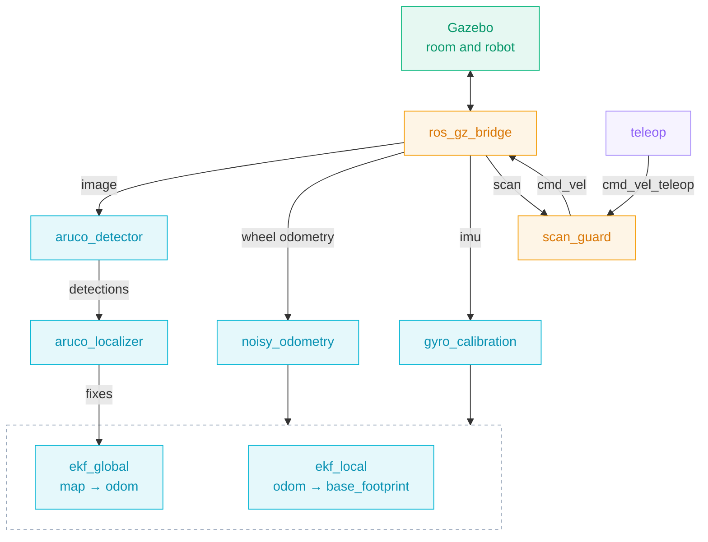

Gazebo simulates the room and the robot, and `ros_gz_bridge` passes its sensors to ROS 2 and the
velocity commands back. The robot's nodes only see what a real robot would get from its sensors.
Gazebo also publishes the true pose on `/ground_truth`, which never reaches TF and only the
experiments read.

| Node | Reads | Publishes |
|---|---|---|
| `aruco_detector` | `/camera/image`, `/camera/camera_info` | `/aruco/detections`, and `/aruco/image` and `/aruco/markers` for watching |
| `aruco_localizer` | `/aruco/detections`, TF | `/aruco/robot_pose`, and `/aruco/robot_pose_markers` and `/aruco/marker_map` for RViz |
| `noisy_odometry` | `/sim/wheel_odometry` | `/wheel/odometry` |
| `gyro_calibration` | `/imu` | `/imu/calibrated` |
| `ekf_local` | `/wheel/odometry`, `/imu/calibrated` | `/odometry/local`, TF `odom → base_footprint` |
| `ekf_global` | the same, and `/aruco/robot_pose` | `/odometry/global`, TF `map → odom` |
| `scan_guard` | `/cmd_vel_teleop`, `/scan` | `/cmd_vel`, and `/scan_guard/zones` for RViz |

## How each layer works

### The lab

<p align="center">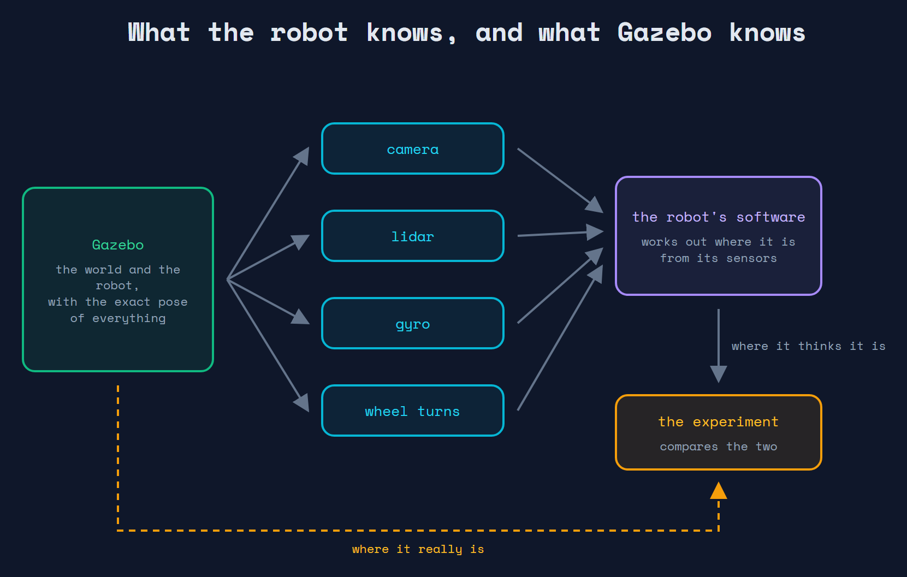</p>

- **The world.** `aruco_world/scripts/build_world.py` generates it. Each marker is given by its
  position and the direction it faces, and the same script writes the detector's parameters, the
  marker map and the robot's start pose. Ten markers (DICT_4X4_50, 15 cm) sit on posts, walls, the
  side of a box and the floor.
- **The robot.** A small differential robot with a camera, a 2D lidar and an IMU, described once in
  `aruco_world/urdf/camera_bot.urdf.xacro`. Gazebo builds it from that file and
  `robot_state_publisher` turns it into TF.
- **The true pose.** Gazebo publishes where the robot really is on `/ground_truth`. None of the
  robot's nodes subscribe to it.

### Perception

<p align="center">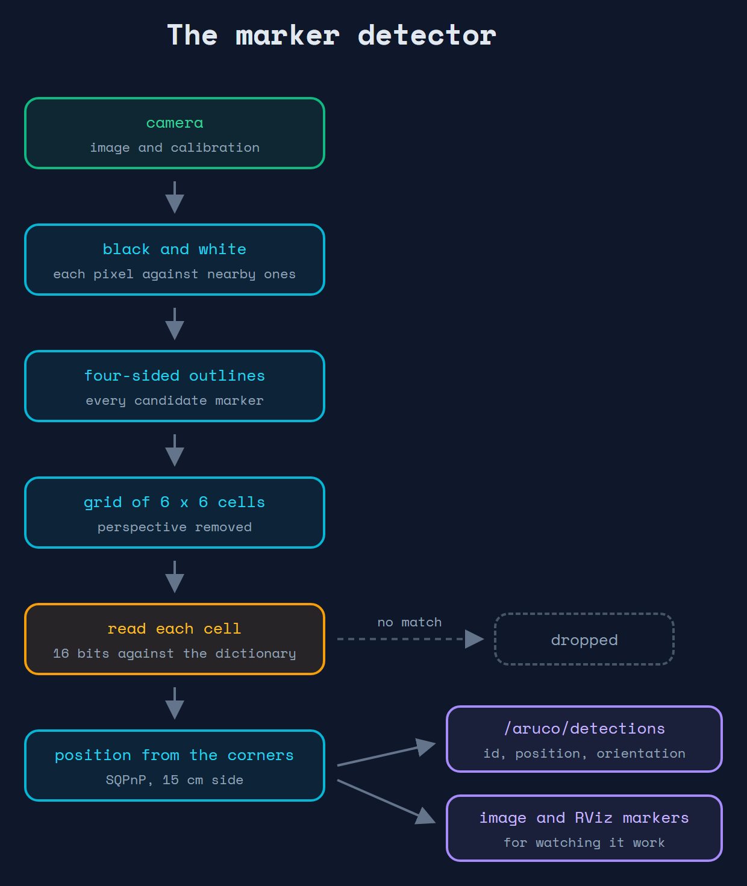</p>

For every camera frame, `aruco_detector` publishes each marker's id, pose, distance, viewing angle,
reprojection error and ambiguity on `/aruco/detections`. It has no tie to the simulation, and
remapping `image` and `camera_info` is enough to run it on any camera.

<p align="center">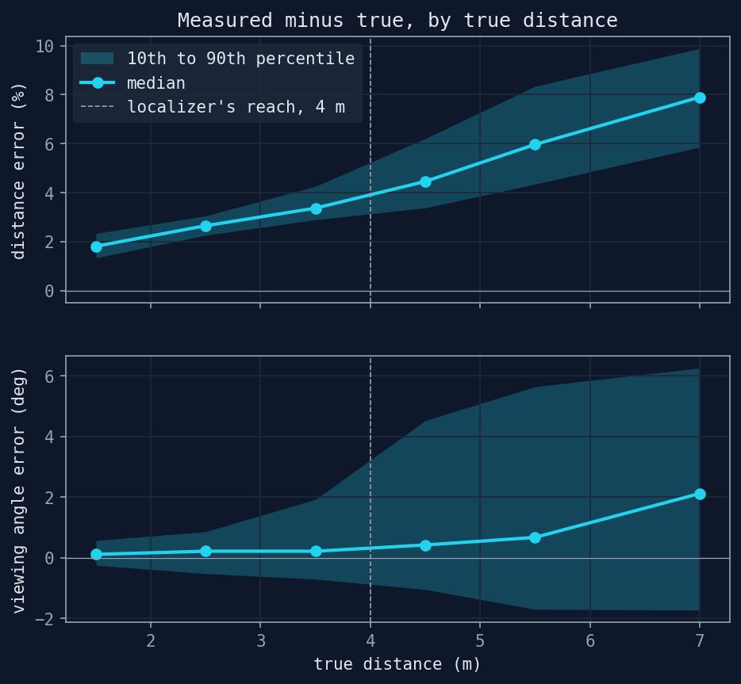</p>

### Safety

<p align="center">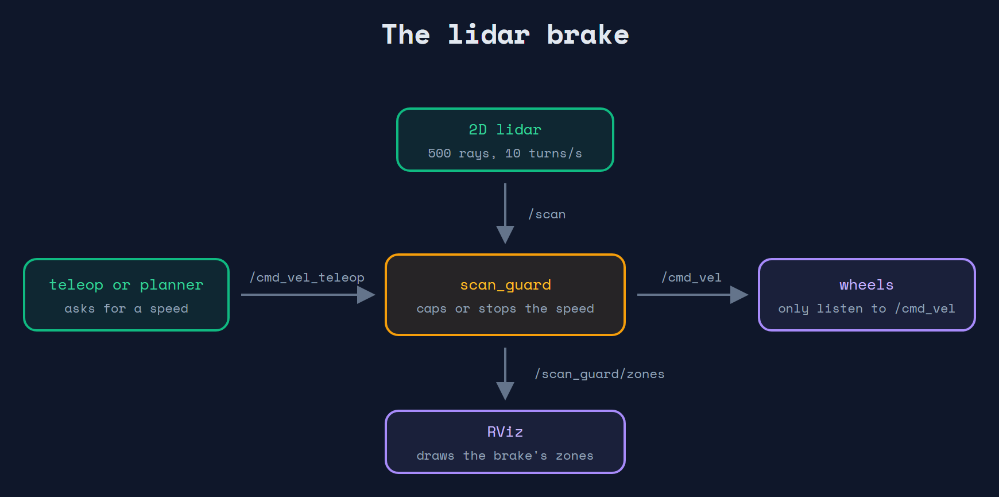</p>

A 360° 2D lidar feeds `scan_guard`, the only node that publishes on `/cmd_vel`. Drivers publish on
`/cmd_vel_teleop`, and the guard passes their commands on. An obstacle in the stop zone stops the
robot, one in the slow zone caps its speed, and without a recent scan the robot holds still.

<p align="center">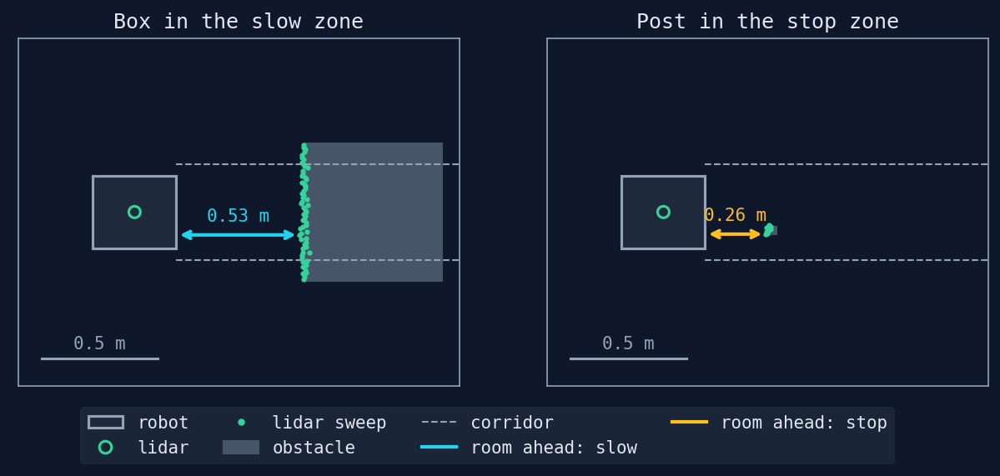</p>

### Localization

<p align="center">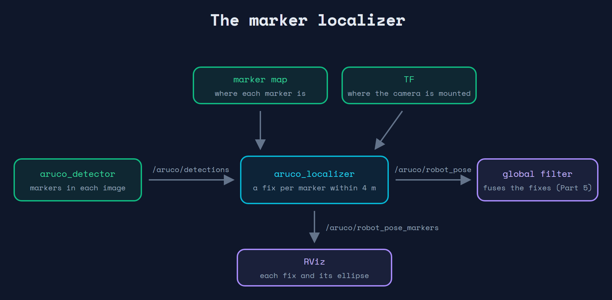</p>

For each detected marker whose place is known, `aruco_localizer` works out where the robot must
be for the camera to see the marker that way. That is a fix, published on `/aruco/robot_pose` with a
covariance that grows with distance, faster to the side than along the line of sight. Past 4 m no
fix is published.

<p align="center">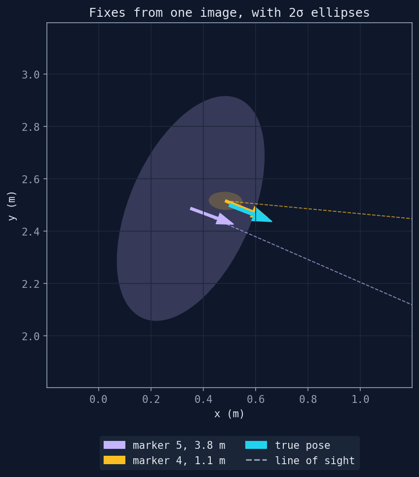</p>

### Fusion

<p align="center">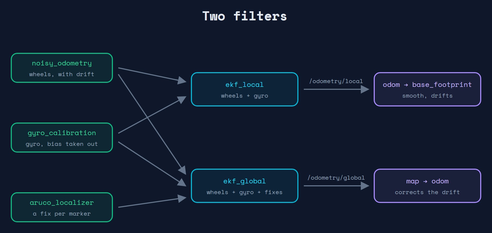</p>

- **The wheels.** Gazebo's wheel odometry is close to perfect, and `noisy_odometry` publishes a copy
  that drifts like a real robot's.
- **The gyro.** A low-cost gyro starts with a small bias. `gyro_calibration` measures it while the
  robot stands still for a few seconds after start-up and takes it out.
- **Two filters.** Following REP 105, `ekf_local` combines the wheels and the gyro into a smooth
  pose in `odom` that drifts. `ekf_global` adds the marker fixes and publishes `map -> odom`, the
  drift those fixes correct. It drops any fix more than 3 sigma from its estimate.

<p align="center">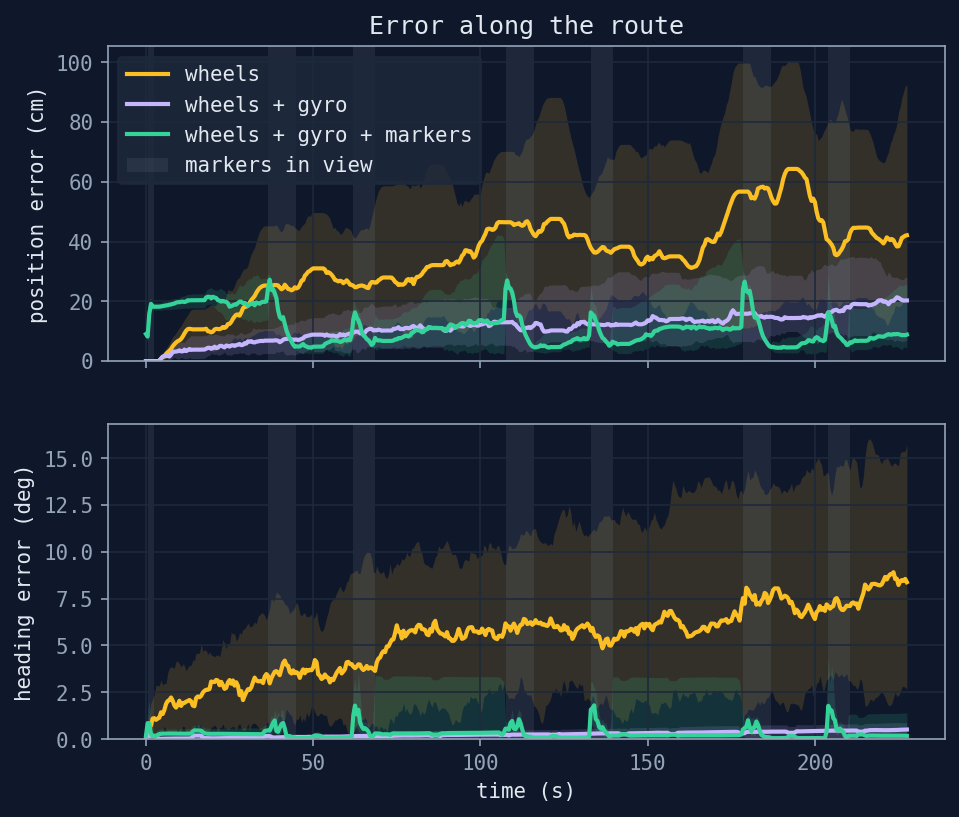</p>

## Key decisions

| Decision | Why |
|---|---|
| The world comes from a script | Moving a marker is a one-line change, and nothing that depends on a marker's place is copied by hand. |
| One URDF for Gazebo and TF | The camera that renders the images and the frame that places the detections cannot drift apart. |
| Wheels that collide as spheres | A cylinder rests on the edges of its rim, and turning on the inner edges shortens the wheel separation the odometry assumes. |
| Corners refined within 2 px | On a far marker, OpenCV's default window takes in the inner cells, whose edges drag every corner toward the centre. |
| Bits read from the middle of each cell | A cell a few pixels wide takes in the blur of its neighbours, and one wrong bit drops a `DICT_4X4_50` marker. |
| Pose from SQPnP | Being globally optimal, it returns the pose that best fits the four corners and never flips a marker to face away from the camera. |
| One fix per marker | A filter that also knows the odometry weighs them, and separate fixes show which marker said what. |
| Two filters, as in REP 105 | A controller can read `odom`, which never jumps, and the robot's place in the room comes from `map`, which does not drift. |
| The gyro's bias taken out at start-up | Neither filter estimates a sensor's bias, and an uncorrected bias would go straight into the heading. |
| Fixes gated at 3 sigma | One view sends many fixes a second with nearly the same error, and a looser gate lets a view that is off drag the estimate along. |
| The guard owns `/cmd_vel` | Drivers publish on a topic of their own, which leaves room for anything that can veto a command to sit in between. |
| Cores without ROS | Detection, localization, drift, bias and the guard's decisions are plain Python, tested in CI with no simulator. |

## Limitations

- Rendered images are clean, with no sensor noise, motion blur or lens distortion, and a single sun
  that never moves lights the room. Detection here is a best case.
- A marker whose cells are only a few pixels wide is read part of the time. For a far marker seen
  almost head-on, the viewing angle and the orientation are poorly determined.
- The detector's distances come out slightly long, more on far and oblique markers. The localizer's
  covariance is wide enough to absorb it, and that puts a floor on how close the global estimate
  gets.
- The wheel drift is random and zero-mean. A real robot's also has a part that always pulls the same
  way.
- The gyro's bias is measured once, and the robot has to stand still for a few seconds after
  start-up. A real gyro's bias also wanders with temperature and time.
- With no marker in range, the global estimate relies on the wheels and the gyro alone, and it
  drifts until the next fix.
- The global filter takes every fix as independent, and consecutive frames of one view carry nearly
  the same error. A fix's covariance also leaves out that its sideways spread and its heading error
  come from the same orientation error.
- Apart from range noise the simulated lidar is ideal. Glass and mirrors behave like walls, sunlight
  never blinds it, and a whole scan is captured at one instant. It sees a single plane 0.30 m above
  the floor, and the floor marker or anything overhanging is invisible to it.
- The guard is a teaching example with no safety certification. It does not check turning in place,
  and a thin object far away may return too few rays to count.
- The filters assume a flat floor and a level robot.
- On modest hardware the simulation runs slower than real time, and the camera and lidar rates drop
  with it.

## Quickstart

Under WSL2, set `GALLIUM_DRIVER=d3d12` so Gazebo renders on the GPU, and on a machine with more
than one GPU, `MESA_D3D12_DEFAULT_ADAPTER_NAME` (for example `NVIDIA`) to pick which one.

```bash
mkdir -p ~/ros2_ws/src && cd ~/ros2_ws/src
git clone https://github.com/KevDP/ros2-aruco-world.git
cd ~/ros2_ws && colcon build --symlink-install
source install/setup.bash
ros2 launch aruco_world world.launch.py
```

It opens Gazebo and RViz. Launch arguments:

- `gz_gui:=false`: RViz only, lighter.
- `rviz:=false`, `image_view:=true`: no RViz, or a separate camera window.
- `detector:=false`: the raw camera only.
- `guard:=false`: no lidar guard.
- `wheel_collision:=cylinder`: the wheels' drawn shape as their collision, to compare with the
  sphere.
- `drift_seed:=7`: the same wheel drift on every start.

Drive it from another terminal (keys `i`, `j`, `l`, `,`, `k`). The guard listens on
`/cmd_vel_teleop`, and teleop is remapped there:

```bash
ros2 run teleop_twist_keyboard teleop_twist_keyboard --ros-args -r cmd_vel:=cmd_vel_teleop
```

With `guard:=false`, drop the remap and teleop drives `/cmd_vel` directly.

Compare the global filter's estimate with where the robot really is:

```bash
ros2 topic echo /odometry/global --field pose.pose.position
```

```bash
ros2 topic echo /ground_truth --field pose.pose.position
```

In RViz, the green trail is the true path and the blue one is the global estimate, drawn with its
uncertainty. The gap between the `map` and `odom` axes is the drift the markers have corrected.

Run the detector on any other camera:

```bash
ros2 run aruco_detector detector --ros-args \
  -p dictionary:=DICT_4X4_50 -p marker_length:=0.15 \
  -r image:=/my_camera/image -r camera_info:=/my_camera/camera_info
```

Save a camera frame, raw and annotated:

```bash
ros2 run aruco_world camera_snapshot.py --out /tmp/aruco
```

After moving a marker in `build_world.py`, regenerate the world and rebuild, from the repository
root:

```bash
cd aruco_world && python3 scripts/build_world.py && cd ~/ros2_ws && colcon build --symlink-install
```

Lint and test without ROS, one pytest run per package so each finds its own settings:

```bash
pip install ruff==0.16.10 pytest numpy opencv-python-headless
ruff check .
for p in aruco_detector aruco_localization noisy_odometry scan_guard gyro_calibration; do pytest -q $p/test; done
```

## Experiments

Each script runs against a fresh simulation, and its report rebuilds the tables and figures from the
raw numbers it saved. `experiments/README.md` explains each one.

| Experiment | Measures | Part |
|---|---|---|
| `visibility.py` | which markers the robot reads from each spot of the room | 1 |
| `turning.py` | the wheel odometry's turns against the true ones, with cylinder and sphere wheels | 1 |
| `camera_views.py` | what the camera sees from two poses, markers read and missed | 2 |
| `perception.py` | how often markers are read, and the error of their pose, by distance and angle | 2 |
| `guard_view.py` | what the lidar sees with an obstacle in each zone | 3 |
| `stopping.py` | how much room the guard leaves at each speed | 3 |
| `localization.py` | each fix's error against the true pose, by distance and angle | 4 |
| `fusion.py` | each estimate's error along a 51 m route, over 30 runs | 5 |

```bash
experiments/sim.sh -- python3 experiments/visibility.py
python3 experiments/visibility_report.py
```

## Repository structure

```
aruco_world/           simulation package
  config/              Gazebo bridge, guard zones, localizer limits, filters, odometry drift,
                       gyro calibration, and the detector parameters, marker map and robot
                       start that build_world.py generates
  launch/              world.launch.py
  models/              aruco_<id> (generated), and camera_bot, the robot's SDF, for reference
  rviz/                aruco_world.rviz
  scripts/             build_world.py (generator), camera_snapshot.py
  urdf/                camera_bot.urdf.xacro, the robot
  worlds/              aruco_room.sdf (generated)
aruco_detector/        detection package: detection.py (no ROS), node.py, tests
aruco_interfaces/      MarkerDetection and MarkerDetectionArray
aruco_localization/    localization package: localization.py (no ROS), node.py, tests
noisy_odometry/        odometry drift package: drift.py (no ROS), node.py, tests
gyro_calibration/      gyro bias package: bias.py (no ROS), node.py, tests
scan_guard/            lidar guard package: guard.py (no ROS), node.py, tests
experiments/           scenarios checked against the true pose, their reports and results
docs/diagrams/         the architecture diagrams of each layer
.github/workflows/     CI: ruff and every package's tests
```
